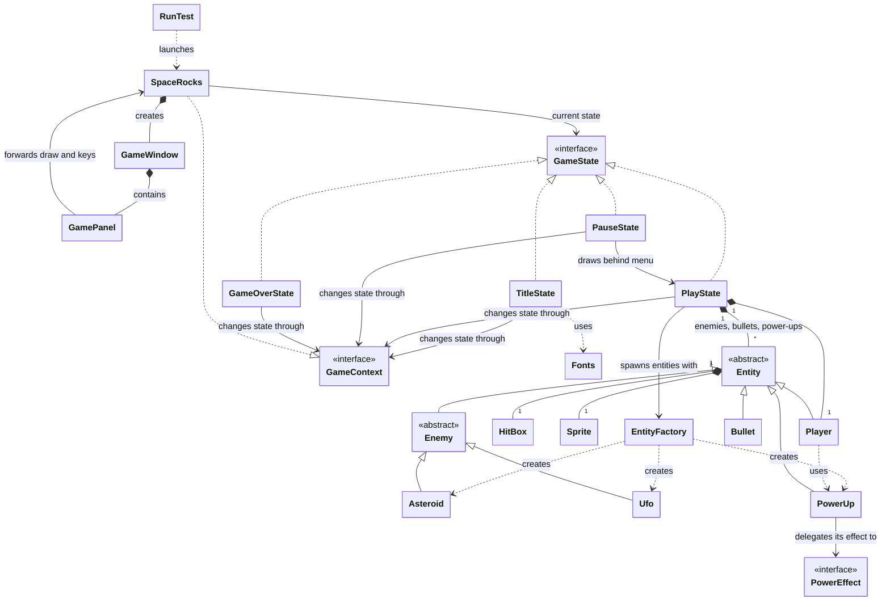

# SpaceRocks
The (Proprietary) new software running everyones favorite retro arcade shooter SpaceRocks! (totally not an asteroids clone shhhhh)

## Project Description
 
This project aims to be a Java based, OO extension of the arcade game Asteroids with
added powerups and different types of obstacles. The player of this game will control a
spaceship which can rotate, move around, and fire projectiles which will interact with
the other objects (Asteroid variations) by breaking them up into smaller pieces until
they are eventually destroyed. Any collision of the player's ship to an asteroid will
kill the player and end the game with a score calculated using roughly
(asteroidvar1*amountDestroyed + asteroidvar2*amountdestroyed2...). The game, much like
its parent game, will increase in difficulty as time goes on by adding more and more
asteroids to the screen at a time.
 
## Key Features:
 
- A player controlled ship with movement, rotation, and a shooting mechanics

- Multiple types of asteroids with different behaviors and required damage to break / destroy

- UFOs that will appear periodically and shoot at the player

- Collision between the ship and asteroids/ufos

- Collision between the projectiles fired by the ship and the ``Enemy'' objects

- Powerups that will increase damage, accuracy, number of shots fired at a time, etc.

- A game class that will handle the main game logic loop much like the polymorphia class in HW2

- Graphical interface in a window that gets opened through running the code

    - This includes sub-interfaces, like a pause menu, settings, and a title screen

- A scoring system based on the amount of points the player receives from shooting enemies
 
This Project will, of course, be implemented using OO principles, with distinct classes
representing the entities within the game, these will inherit from abstract classes when
possible for concepts like an enemy, where all the UFO's and Asteroids will share at
least some common logic.

## Proposed Class Structure
Updated to reflect changes btw

## Legend for Class Structure Diagram

| Symbol | Name | Meaning in this diagram |
|---|---|---|
| `<<interface>>` | Interface | Defines methods that implementing classes must provide (e.g. `GameState`). |
| `<<abstract>>` | Abstract class | Can't be created directly; only its subclasses can (e.g. `Entity`, `Enemy`). |
| `<\|--` | Inheritance | The class on the right extends the class on the left (e.g. `Enemy <\|-- Asteroid`). |
| `<\|..` | Realization | The class on the right implements the interface on the left (e.g. `GameState <\|.. PlayState`). |
| `*--` | Composition | The owner creates and controls the other class; it lives and dies with the owner (e.g. `PlayState *-- Player`). |
| `-->` | Association | The class holds a reference to the other class (e.g. `SpaceRocks --> GameState`). |
| `..>` | Dependency | The class uses the other briefly, such as creating it or passing it around (e.g. `EntityFactory ..> Asteroid`). |
| `"1"` | Multiplicity: one | Exactly one instance on that side of the relationship. |
| `"*"` | Multiplicity: many | Zero or more instances on that side of the relationship. |
| `: label` | Relationship label | Plain-text description of the relationship; doesn't change its meaning. |

## Progress So Far (9/29)

Do I want to write documentation? no. not really. should I because I dont know what the specifications of the final project will be? probably

### RunTest.java

This is the class I'm going to be using to just play the game out of a window in my computer. Just run this file in your ide and the game should (eventually) compile and run. this will probably be the catch all for specific method testing too, so this might be added to the gitignore in future commits.

### Let's talk about GamePanel

- Okay so GamePanel has got this import called javax.swing.Jpanel and then GamePanel goes on to extend it. what exactly does this do? this is swings blank component. something that can draw itself and receive input. this is what handles drawing the screen and receiving keyboard input

- JFrame is what holds the window, the title bar, and close buttons, its essentially a picture frame. everything gets drawn onto the Jpanel

- GamePanel also implements KeyListener, which essentially makes it liable to provide the method calls for all keyboard events (The import messages were very red and angry about this). but this does let the panel directly receive keyboard input

- final ints declare the size of the window. do I eventually maybe want the window to be resizeable? maybe. i dont know. its early in the process.

#### Constructor

- this.game = game stores the SpaceRocks reference passed in by GameWindow's constructor
- sets the preferred size od the window, the background
- double buffering to prevent screen flicker
- focusable to recognize key strokes, key listener to listen for them

#### paintComponent

- super.paintComponent just paints the background black, game.draw is a method within SpaceRocks itself that has yet to be defined. that method will eventually handle drawing the current state

#### Overrides on KeyEvents

- needed for the window to recognize key events itself

### GameWindow (The Picture Frame)

- This here is the class that takes the JFrame, packs the frame with the GamePanel object for the SpaceRocks game itself. the SpaceRocks game of course, is sent in as a this object from SpaceRocks' constructor when it initializes the GameWindow

- Title is currently "Space Rocks", when you close the window the program terminates, and right now resizeable is false because of our fixed width/height from before

- setLocationRelativeTo(null) centers the window on your screen, i dont know a whole lot about this, just that if you set the parameter to null it centers, requestFocusInWindow() tabs you into the window

- getPanel() returns the panel currently inside the frame, this is useful because the frame itself has very little we are actually going to be interacting with

### SpaceRocks (The Father Class in which Everything Runs)

- Okay so eventually there will be more methods and whatever in here, I wrote this class out so that you can run SpaceRocksTest and a window will pop up by making a SpaceRocks Object

- one interesting consideration here is that currently, this window runs at ~60fps. right now your computer will, 60 times per second, paint the screen black. whatever, what's important is that there is a timer and on a schedule that timer executes commands

- draw() is empty, you need gamestates to change that and I dont, once there are gamestates youll be able to update

- keyPressed and keyReleased: these are for gamePanel, because game calls keyPressed and keyReleased they need to be defined here.

### Import Notes

- Swing: this is the guy that gives you JFrame and Jpanel. these are responsible for the window you see pop up on your computer

- awt.event.KeyEvent and awt.event.KeyListener. game panel implements these interfaces to recognize key strokes

- awt.Color is really just used for setBackground in GamePanel. lets not be too hasty though and say this wont be used at all, im sure we'll get use out of it

- awt.Graphics, awt.Graphics2D, awt.Dimension: these are all in some way about handling the window, a dimension is essentially a tuple if youre familiar with python, and the graphics packages get used in paintComponent/draw

#### One last thing then I'm done, promise

- I know we were talking about OpenGL for this, as you may have noticed, this does not use JOGL, this uses stuff out of the awt and swing libraries. can we change this? yes. should we make that decision soon? also yes. this is just like the "most basic" java window when I first opened up the google and asked it how I might go about doing this. it seems entirely possible to do the whole game using these imports but I dont have the knowledge about these libraries yet to fully realize what these are and aren't capable of

## Dev Log (10/6): A Ship that Flies Around Your Screen

Lord, okay. I've spent the better part of 16 hours coding past what we were at last time and I made some fun things, but I simply cannot stand writing documentation. It is currently 2:06am and I am god's highest soldier right now so let's knock this out before I realize I am writing this

### New to the Family: States

You know how in my last dev log I was talking a little bit about game states? well here they are, lets start with GameState

#### GameState

GameState exists as an interface. really, it exists to give all other state classes 4 methods that they must override: update, draw, keypressed, and keyreleased.

- Update will do all of the calculations for all of the objects that will eventually move, like the player

- Draw is what will physically be drawn to our very good friend Jframe

- keyPressed will turn into the switch case for what keys are being pressed, where we then change the value of booleans that appear in update

- keyReleased will basically just act as the event to change aforementioned booleans back to false.

Lets look at TitleState now

- Constructor: just takes the parent game in so it knows what it's attatched to

- Update: no objects to be rendered in here yet, unless we want to get fancy and make a title animation or something, this is empty for the time being

- Draw: you may notice the parameter is a Graphics2D object, this is our paintbrush (its really a very complicated object that I'm a little scared of but shut up) and brother, we are vincent van gogh. using our boy, g, we draw 2 pieces of text onto the title screen. we do this by using a font called Hyperspace, how do you implement that? im glad you ask

### The Fonts Class

Who says you need to finish the last section to start a new one? nobody? sick

you may notice we import font here, Fonts is essentially a helper class that just allows us to load in our own fonts as static variables

This is where Hyperspace ended up, the actual font file is in /resources/fonts but we load it in here

The load method just calls the static Font method createFont which does most of the heavy lifting, and we take the file in as an InputStream. TRUETYPE_FONT allows us to take in a font file with outlines, which Hyperspace does. otherwise if we catch any errors, we just load the default Monospaced font in instead. its safe, and it works

### Back to Business

keyReleased: empty, subject to change if we want a more cohesive title screen/menu

keyPressed: only looks for the enter key, and when its found it sets the gamestate to PlayState

#### PlayState: the bread and butter

You may notice this also takes in the game, this will be a constant trend, the state is bound to the game. more importantly, all of our little critters, including the player, the enemies, and the powerups will exist in here, not the game.

The booleans here are up, left, right, there will eventually be one for the shooting but I haven't got to that yet. I figured the dev log would be more important. our KeyEvent methods will set these booleans to true when their respective key events happen. Notice these methods are constantly being run all the way from the addKeyListener(this) in GamePanel's constructor, so you never have to call these anywhere

Right now we also just have a player in here, this is what you control in-game, it would probably be smart to put a couple factory classes in here for making enemies and powerups and whatnot, but thats later. What is a player? oh fuck is he gonna do the thing where he interrupts the section aga-

### Player Class

wait? doesn't player inherit from Entity?

### Entity Class: the ACTUAL Bread and butter

man, where do I even begin? I did this one in an all nighter on my own volition and this is where the spaghetti code really comes into play. It's just a class in development before we really know the full scope of all the entity decisions, and then i fear it still might be a work in progress until like 80% into this whole shebang. whatever

Lets sit down and make some general assumptions about what an entity needs in a game:

- Probably needs to keep track of its position for gamepanel

- probably needs to know how its speed on the screen for when the game updates

- probably needs to know if its alive

- probably needs a hitbox, and probably needs a sprite to show on the screen

### Hitbox? Sprite?

These fellas came into existence when I was driving on the 36 back from work, thinking about geometry dash hitboxes (I'm sick in the head like that), and decided we should probably do this too.

#### HitBox

For the time being, all hitboxes are circles. I figured it would be the most accomodating shape for all the enemies. this can most definitely change if we would like it to. 

- HitBox holds onto Entity like GameState holds onto SpaceRocks. any HitBox object will also need a radius because it's a circle

- getRadius is really just a helper method for intersects

- intersects: takes in another hitbox, subtracts their x and y position, and then compares that distance to the sum of the two radii. this is a euclidean inequality so everything is squared. if the distance is greater than the radii, then it returns false, otherwise they are touching and so they do intersect

#### Sprite

Sprite suffers from the fact that we're taking in an image, the responsibility falls on him to do the heavy lifting. we believe in you Sprite

- We first make a cache for O(1) access to pixels in the image we are taking in for a sprite, we take the image in as a BufferedImage object, and we grab the dimensions of how big we want our sprite to be.

- we must load this BufferedImage, again, we load it in as an InputStream object, and then read it in using ImageIO to read the pixels. this is the full size image in /resources/sprites. everything else here is just error handling

- draw: have you ever heard of an Affine transform? no? thats okay, i forgive you. an affine transform is essentially a whole bunch of linear algebra that preserves the straightness and parallelness of lines in an image when you do something like rotate around (which is what our player is going to be doing). java conveniently has a class to handle this and it is compatible with Graphics2D, what a score. so we grab the transform object from our g object (the paintbrush), translate and rotate it, draw it, and then we set the transform on the old state to update it. all this does is really draw an image of our size prefernce to a certain angle while preserving what the image looks like

### Where were we? Oh, Entity

okay so from those generalizations we made above, we have

- x,y position, theta as heading

- velocity for x, y, theta dx, dy, dtheta

- alive boolean

- hitbox and sprite

You may notice theres a couple of constructors here. we should be doing this here, and probably to a larger extent than I've already done. I really have just built out this class to make the player be able to show up on the screen for right now. 

- First constructor: no arguments, centers the entity on the center of the screen, sets its velocities to 0 and the angle heading to 0. its hitbox has a radius of 1 for right now, i can tell you right now thats probably going to be too small, but it works for now. this also just loads in the player sprite with a width of 30x30 here. what's neat about this one is you can just call this with no arguments and it will just pop out the player object, which made calling super() in Player easier.

- Second constructor: specifies position, heading, x, y, and theta velocities, the radius for the hitbox, and the path to the sprite image. this will maybe the class we do a builder pattern on. i dont really know the specs of the project but if its required.

- update: velocities get added to position and heading, calls a function called wrap(), if youre looking at version history, you will notice the "wrap is gonna be problematic for bullet" comment and i actually fixed this so dont even worry about it

- wrap(): calls the willwrap method on the entity object. this is an abstract method defined by inherited classes. player does wrap, bullets might not, maybe powerups wont either. still open to speculation. otherwise this method just acts as a "go in one side, come out the other" position adjustment on the screen.

- collidesWith(Entity other): returns whether or not hitboxes of two entities are colliding, this will be required for entity death later on.

- Otherwise, entity just has a whole bunch of get functions for position and whatnot

- Oh, and kill, that sets alive to false, this will eventually be used to stop drawing the objects when they die, alse for gamestate stuff

### Where does that bring us back to? Player?

- First we define some variables that will need tweaking at some point, turn speed is in radians/frame^2, thrust is in pixels/frame^2, and friction is an exponential decline function. this means TURN_SPEED, THRUST, and FRICTION are all acceleration values in some way. an important note here is that currently there is no cap on speed in any way, and we may want to fix that 

- writing the Entity constructors in a cool enough way allows us to just super the constructors for the most part

- we also have to define all of the movement methods that we will use in PlayState's update method. remember the booleans? anyways those ones are

- rotateLeft: subtracts turn speed from theta

- rotateRight: adds turn speed to theta

- thrust: adds speed to dx and dy in proportion to direction using sin and cosine

- update: friction is multiplied to the speed of the object to eventually slow it down. it then calls super.update() which adds the speed to the position.

- draw: draws only the sprite

- willWrap: true for the player because we wanna fly around freely in the game window

### Back to PlayState for the final time

Look at us, we've made it so far. we're almost done, prommy.

- the update here calls the player object's movement function based on the booleans that are set true during keyevents, and then calls player's update

- the draw just defaults back to the players draw which puts the sprite on the screen

- the rest are keyevents, w for thurst, a for left, d for right. classic wasd for the win. I'm thinking spacebar for shoot but thats a problem for another day. 

It is important to note that there is no implementation for a pause state, or a game over state yet. a pause state will hold an instance of the playstate so you can resume when you unpause, and we're gonna have to define player death and everything before we even get to a game over. theres definitely still much work to be done on this. we persist nonetheless.

Now running RunTest.java in your ide should pop out a window that you can pilot a little ship around. isnt that exciting? quite a bit more work than anticipated to reach such an early milestone, but such is life.

okay and that should bring us up to speed. until next time.

## Design Patterns

Okay if you've seen the readme you know I like to go on and on to myself in here. As I am writing this, I am preparing for the mid-project review. My first step was to come back after a hiatus from working on this, look through it, and do some optimizations. these introduce some patterns and more stuff that we've been working on in class, so if reading this isn't exactly consistent with the rest of my writing, that's why.

### State (in progress)

- GameState is the interface for this pattern, TitleState, GameOverState, PlayState, and PauseState implement the interface. GameState takes a GameContext object in (which SpaceRocks implements). Each state is responsible for its own update(), draw(), and keyboard input. these states switch themselves using GameContext.setState() 

### Factory (in progress)

- Originally there were going to be more factories here but I realized we really just need 1 (right now) to handle all the entites . Introduce: EntityFactory (ooh, ahh). PlayState will ask the factory for kind of everything. bullets? handled. enemies? you know it. powerups? have you not been listening to me? this ensures that all the spawn logic will be handled in one place which is nice. bullets arent implemented right now so you wont see a createBullet() method just yet

### Strategy (in progress)

This is what I got so far:

- PowerEffect is the strategy interface, it has one method, apply(Player p), which is whatever the powerup actually does to the player. each PowerUp holds a PowerEffect that gets passed into its constructor, and EntityFactory.createPowerUp(effect) hands it through, so the PowerUp itself doesn't care what kind of powerup it is. a speed boost and a rapid fire powerup are the same PowerUp class with a different PowerEffect plugged in, this means we dont need all the subclasses for powerup (yay)

- the player's firing logic should also be swappable at runtime the same way, so powerups can change the bullet spray or speed or whatnot. still undecided on whether special enemies get the strategy treatment too or just become subclasses

### Template (in progress)

- I wrote into these into code before I knew what a template pattern was, but upon returning to this project it does qualify and so it is being mentioned for the mid-project review. Entity.update() fixes the order of movement (moves and then runs wrap()) by calling the abstract hook willWrap(). Player adds friction before it calls super.update() I'm sure that more of these will appear as the code progresses forward

## To Do (Rough Estimate for Mid-Project Review)

### Collisions and Game Over

- [ ] Raise the default hitbox radius in Entity from 1 to roughly the sprite's size (around 12-15).
- [ ] Spawn enemies at a random screen edge in EntityFactory so they don't start on top of the player.
- [ ] Check player vs enemy collisions in PlayState.update() and switch to GameOverState on a hit.
- [ ] Draw "GAME OVER", the final score, and restart/quit instructions in GameOverState.draw().
- [ ] Make SpaceRocks.quit() actually close the game.

### Shooting

- [ ] Give Bullet a constructor that takes the player's position and heading and sets its velocity from them.
- [ ] Draw bullets in Bullet.draw() using bullet.png or a small circle.
- [ ] Kill bullets after a set number of frames or once they leave the screen.
- [ ] Add a createBullet() method to EntityFactory.
- [ ] Fire a bullet on spacebar in PlayState with a short cooldown between shots.
- [ ] Check bullet vs enemy collisions and kill both on a hit.
- [ ] Remove dead entities from the list each frame with entities.removeIf().

### Scoring and Difficulty

- [ ] Add a score to PlayState that goes up based on which kind of enemy was destroyed.
- [ ] Draw the current score on screen during play.
- [ ] Spawn more enemies over time so the game gets harder the longer you survive.

### Enemies

- [ ] Split asteroids into smaller pieces when shot until the smallest size is destroyed.
- [ ] Give different asteroid types different health and point values.
- [ ] Make UFOs appear periodically and shoot at the player.
- [ ] Decide whether special enemies use the Strategy pattern or plain subclasses.

### Power-ups

- [ ] Write at least one concrete PowerEffect implementation, like a speed boost or rapid fire.
- [ ] Change doPower() to doPower(Player p) and have it call powerEffect.apply(p).
- [ ] Spawn power-ups occasionally and apply their effect when the player touches one.
- [ ] Make the player's firing behavior swappable at runtime so power-ups can change shot spread or speed.
- [ ] Crop Null.png or add a real power-up sprite so it isn't squashed down to 30x30.

### Menus

- [ ] Make PauseState hold the paused PlayState, draw it with a "PAUSED" overlay, and resume on Esc.
- [ ] Add a pause key to PlayState.keyPressed() that switches to PauseState.
- [ ] Build the settings screen mentioned in the Key Features tab at the top of the readme.

### Cleanup and Tests

- [ ] Write more tests as features get written, like bullets not wrapping, game over transitions, and pause/resume.
- [ ] Load the window icon in GameWindow with getResource() so it actually shows up.