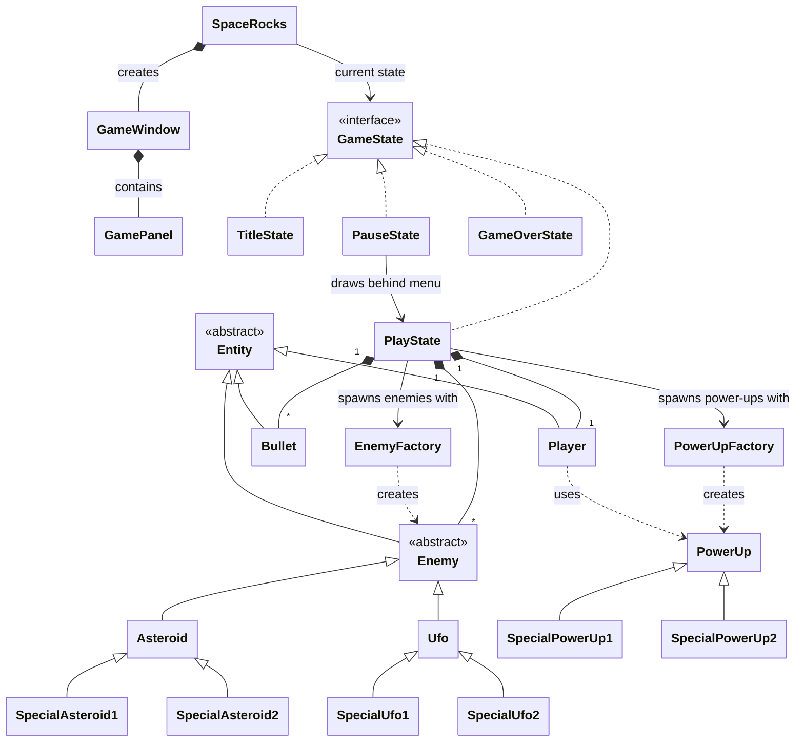

# SpaceRocks
The (Proprietary) new software running everyones favorite retro arcade shooter SpaceRocks! (totally not an asteroids clone shhhhh)

## Project Description
 
This project aims to be a Java based, OO extension of the arcade game Asteroids with
added powerups and different types of obstacles. The player of this game will control a
spaceship which can rotate, move around, and fire projectiles which will interact with
the other objects (Asteroid variations) by breaking them up into smaller pieces until
they are eventually destroyed. Any collision of the player's ship to an asteroid will
kill the player and end the game with a score calculated using roughly
(asteroidvar1*amountDestroyed + asteroidvar2*amountdestroyed2...). The game, much like
its parent game, will increase in difficulty as time goes on by adding more and more
asteroids to the screen at a time.
 
## Key Features:
 
- A player controlled ship with movement, rotation, and a shooting mechanics

- Multiple types of asteroids with different behaviors and required damage to break / destroy

- UFOs that will appear periodically and shoot at the player

- Collision between the ship and asteroids/ufos

- Collision between the projectiles fired by the ship and the ``Enemy'' objects

- Powerups that will increase damage, accuracy, number of shots fired at a time, etc.

- A game class that will handle the main game logic loop much like the polymorphia class in HW2

- Graphical interface in a window that gets opened through running the code

    - This includes sub-interfaces, like a pause menu, settings, and a title screen

- A scoring system based on the amount of points the player receives from shooting enemies
 
This Project will, of course, be implemented using OO principles, with distinct classes
representing the entities within the game, these will inherit from abstract classes when
possible for concepts like an enemy, where all the UFO's and Asteroids will share at
least some common logic.

## Proposed Class Structure

## Legend for Class Structure Diagram

| Symbol | Name | Meaning in this diagram |
|---|---|---|
| `<<interface>>` | Interface | Defines methods that implementing classes must provide (e.g. `GameState`). |
| `<<abstract>>` | Abstract class | Can't be created directly; only its subclasses can (e.g. `Entity`, `Enemy`). |
| `<\|--` | Inheritance | The class on the right extends the class on the left (e.g. `Enemy <\|-- Asteroid`). |
| `<\|..` | Realization | The class on the right implements the interface on the left (e.g. `GameState <\|.. PlayState`). |
| `*--` | Composition | The owner creates and controls the other class; it lives and dies with the owner (e.g. `PlayState *-- Player`). |
| `-->` | Association | The class holds a reference to the other class (e.g. `SpaceRocks --> GameState`). |
| `..>` | Dependency | The class uses the other briefly, such as creating it or passing it around (e.g. `EnemyFactory ..> Enemy`). |
| `"1"` | Multiplicity: one | Exactly one instance on that side of the relationship. |
| `"*"` | Multiplicity: many | Zero or more instances on that side of the relationship. |
| `: label` | Relationship label | Plain-text description of the relationship; doesn't change its meaning. |

## Progress So Far (9/29)

Do I want to write documentation? no. not really. should I because I dont know what the specifications of the final project will be? probably

### RunTest.java

This is the class I'm going to be using to just play the game out of a window in my computer. Just run this file in your ide and the game should (eventually) compile and run. this will probably be the catch all for specific method testing too, so this might be added to the gitignore in future commits.

### Let's talk about GamePanel

- Okay so GamePanel has got this import called javax.swing.Jpanel and then GamePanel goes on to extend it. what exactly does this do? this is swings blank component. something that can draw itself and receive input. this is what handles drawing the screen and receiving keyboard input

- JFrame is what holds the window, the title bar, and close buttons, its essentially a picture frame. everything gets drawn onto the Jpanel

- GamePanel also implements KeyListener, which essentially makes it liable to provide the method calls for all keyboard events (The import messages were very red and angry about this). but this does let the panel directly receive keyboard input

- final ints declare the size of the window. do I eventually maybe want the window to be resizeable? maybe. i dont know. its early in the process.

#### Constructor

- this.game = game stores the SpaceRocks reference passed in by GameWindow's constructor
- sets the preferred size od the window, the background
- double buffering to prevent screen flicker
- focusable to recognize key strokes, key listener to listen for them

#### paintComponent

- super.paintComponent just paints the background black, game.draw is a method within SpaceRocks itself that has yet to be defined. that method will eventually handle drawing the current state

#### Overrides on KeyEvents

- needed for the window to recognize key events itself

### GameWindow (The Picture Frame)

- This here is the class that takes the JFrame, packs the frame with the GamePanel object for the SpaceRocks game itself. the SpaceRocks game of course, is sent in as a this object from SpaceRocks' constructor when it initializes the GameWindow

- Title is currently "Space Rocks", when you close the window the program terminates, and right now resizeable is false because of our fixed width/height from before

- setLocationRelativeTo(null) centers the window on your screen, i dont know a whole lot about this, just that if you set the parameter to null it centers, requestFocusInWindow() tabs you into the window

- getPanel() returns the panel currently inside the frame, this is useful because the frame itself has very little we are actually going to be interacting with

### SpaceRocks (The Father Class in which Everything Runs)

- Okay so eventually there will be more methods and whatever in here, I wrote this class out so that you can run SpaceRocksTest and a window will pop up by making a SpaceRocks Object

- one interesting consideration here is that currently, this window runs at ~60fps. right now your computer will, 60 times per second, paint the screen black. whatever, what's important is that there is a timer and on a schedule that timer executes commands

- draw() is empty, you need gamestates to change that and I dont, once there are gamestates youll be able to update

- keyPressed and keyReleased: these are for gamePanel, because game calls keyPressed and keyReleased they need to be defined here.

## Import Notes

- Swing: this is the guy that gives you JFrame and Jpanel. these are responsible for the window you see pop up on your computer

- awt.event.KeyEvent and awt.event.KeyListener. game panel implements these interfaces to recognize key strokes

- awt.Color is really just used for setBackground in GamePanel. lets not be too hasty though and say this wont be used at all, im sure we'll get use out of it

- awt.Graphics, awt.Graphics2D, awt.Dimension: these are all in some way about handling the window, a dimension is essentially a tuple if youre familiar with python, and the graphics packages get used in paintComponent/draw

## One last thing then I'm done, promise

- I know we were talking about OpenGL for this, as you may have noticed, this does not use JOGL, this uses stuff out of the awt and swing libraries. can we change this? yes. should we make that decision soon? also yes. this is just like the "most basic" java window when I first opened up the google and asked it how I might go about doing this. it seems entirely possible to do the whole game using these imports but I dont have the knowledge about these libraries yet to fully realize what these are and aren't capable of