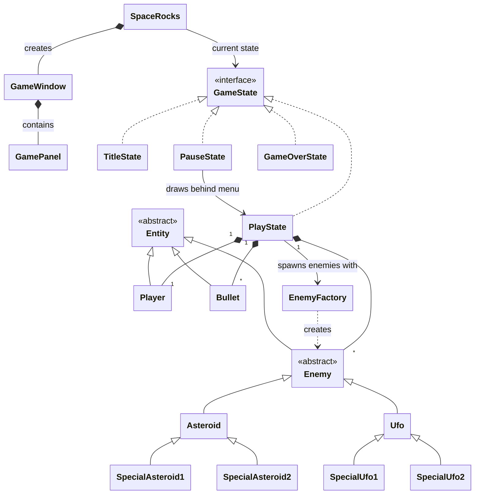

# SpaceRocks
The (Proprietary) new software running everyones favorite retro arcade shooter SpaceRocks! (totally not an asteroids clone shhhhh)

## Project Description
 
This project aims to be a Java based, OO extension of the arcade game Asteroids with
added powerups and different types of obstacles. The player of this game will control a
spaceship which can rotate, move around, and fire projectiles which will interact with
the other objects (Asteroid variations) by breaking them up into smaller pieces until
they are eventually destroyed. Any collision of the player's ship to an asteroid will
kill the player and end the game with a score calculated using roughly
(asteroidvar1*amountDestroyed + asteroidvar2*amountdestroyed2...). The game, much like
its parent game, will increase in difficulty as time goes on by adding more and more
asteroids to the screen at a time.
 
## Key Features:
 
- A player controlled ship with movement, rotation, and a shooting mechanics

- Multiple types of asteroids with different behaviors and required damage to break / destroy

- UFOs that will appear periodically and shoot at the player

- Collision between the ship and asteroids/ufos

- Collision between the projectiles fired by the ship and the ``Enemy'' objects

- Powerups that will increase damage, accuracy, number of shots fired at a time, etc.

- A game class that will handle the main game logic loop much like the polymorphia class in HW2

- Graphical interface in a window that gets opened through running the code

    - This includes sub-interfaces, like a pause menu, settings, and a title screen

- A scoring system based on the amount of points the player receives from shooting enemies
 
This Project will, of course, be implemented using OO principles, with distinct classes
representing the entities within the game, these will inherit from abstract classes when
possible for concepts like an enemy, where all the UFO's and Asteroids will share at
least some common logic.

## Proposed Class Structure

lowkey forgot about powerups, will do this later
